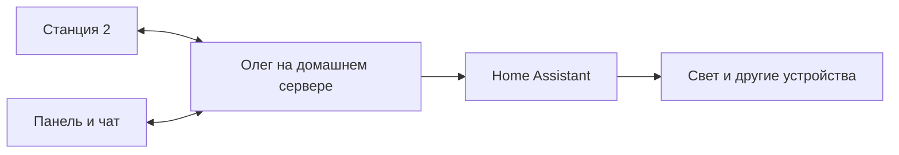

# Свой ИИ в рут Алисы

Я начал этот проект со Станции 2 дома. Хотел, чтобы колонка отвечала голосом Олега, понимала мои команды и включала свет через Home Assistant. Под это появилась панель, где можно менять голос и характер ответов, и отдельный чат для общения с Олегом с компьютера.

## Какие колонки подходят

**Проверена одна модель — Яндекс Станция 2.** Она работает в моей домашней сборке с уже настроенным локальным доступом. Новый сервер обработки из этого репозитория пока общается через браузер. Связь нового сервера со Станцией отдельно ещё не проверена.

| Модель | Статус |
|---|---|
| **Станция 2** | Проверена на моей установке |
| Станция Мини 2 | Кандидат для проверки |
| Станция Миди | Кандидат для проверки |
| Станция Макс | Кандидат для проверки |

Для каждой из трёх моделей надо отдельно проверить локальный доступ, захват звука с микрофонов и воспроизведение ответа на конкретной прошивке. Название модели можно сверить по [справке Яндекса](https://alice.yandex.ru/support/ru/station/identify).

## Панель и чат

Ниже макеты по функциям домашней сборки. Названия полей и расположение элементов на реальной панели могут отличаться.

### Панель управления

| Раздел панели | Что можно настроить |
|---|---|
| **Голос** | Голос Олега, скорость и высота речи |
| **Характер** | Как Олег разговаривает и отвечает |
| **Команды** | Слово активации и фразы вроде «включи свет» |
| **Подсветка** | Эффект, цвет и чувствительность к звуку |
| **Память** | Включение и отключение памяти диалогов |

### Личный чат с Олегом

| Кто | Сообщение |
|---|---|
| **Дима** | Олег, помоги придумать название для домашней сети. |
| **Олег** | Как насчёт «На связи»? Подойдёт и для Wi‑Fi, и для колонки. |
| **Поле ввода** | Напиши Олегу… |

Это пример переписки. Такой чат можно попробовать отдельно от колонки, запустив сервер ниже.



## Попробовать чат без Home Assistant

Для этого режима нужны Python 3.10+ и Ollama. Токен Home Assistant не требуется. Интернет нужен для установки и скачивания модели. Дальше обработка текста идёт через локальный Ollama.

### Windows

Установи [Ollama для Windows](https://docs.ollama.com/windows) и Python. Открой папку репозитория в PowerShell:

```powershell
ollama pull qwen2.5:1.5b
py -3 .\processing-server.py --model qwen2.5:1.5b
```

### Linux

Установи Python и [Ollama для Linux](https://docs.ollama.com/linux). Если Ollama установлен без службы, запусти `ollama serve` в отдельном терминале. Затем в папке репозитория выполни:

```bash
ollama pull qwen2.5:1.5b
python3 processing-server.py --model qwen2.5:1.5b
```

В обоих случаях открой [чат в браузере](http://127.0.0.1:8787). Сервер доступен с того же компьютера. Если порт занят, добавь `--port 8788` и открой новый адрес. Если чат открывается, а ответа нет, проверь, что Ollama запущен и модель есть в `ollama list`. Остановить сервер можно через **Ctrl+C**.

## Перенести домашнюю сборку с Home Assistant

Этот вариант требует приватного архива исходного сервера. Для проверки подойдёт новая папка или отдельная Debian-ВМ.

```bash
python3 prepare-oleg.py --archive /path/to/oleg-private.tar --check
python3 prepare-oleg.py --archive /path/to/oleg-private.tar ./oleg-new
```

1. Укажи URL Home Assistant и долгоживущий токен из его профиля. Скрипт сам проверит доступ к API.
2. В подготовленной папке проверь адреса колонки и остальных устройств. Если используешь Piper, установи зависимости голосовой части в отдельное окружение Python.
3. На рабочем сервере используются `oleg-bridge`, `oleg-web-chat`, `oleg-airplay-output` и `oleg-web-tunnel`. На новой машине пока нужно вручную настроить пути, порты и учётные данные. Туннель нужен только для удалённого доступа, если ты его отдельно настраиваешь.
4. Начни с панели в локальной сети, затем проверь управление светом, голосовой ответ и звук. Для диагностики службы используй `journalctl -u ИМЯ_СЛУЖБЫ -n 50 --no-pager`.

Приватный архив, `ha.token`, ключи, пароли и переписку храни вне Git. Для обычной смены Wi‑Fi на колонке есть [инструкция Яндекса для Станции 2](https://alice.yandex.ru/support/ru/station/settings/change-wifi-gen2).
